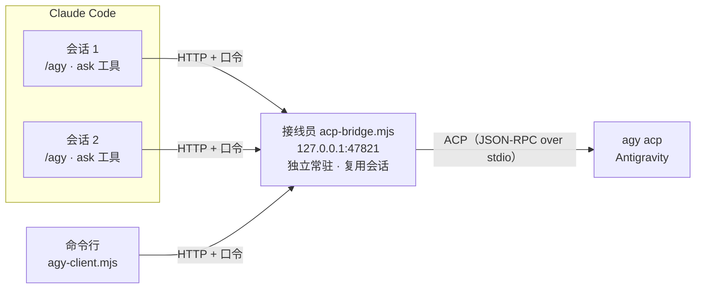
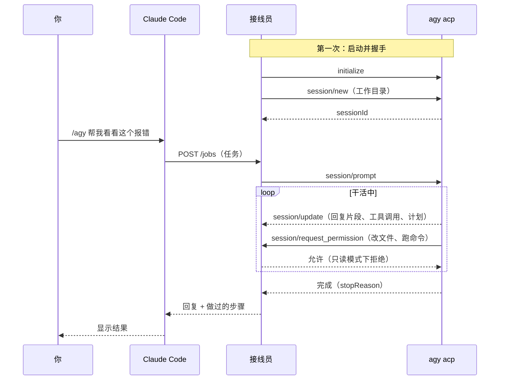

# antigravity-acp

在 **Claude Code** 里把 **Antigravity**（`agy`）当子代理用。

底层走 **ACP**（Agent Client Protocol）：后台一直开着一个 `agy acp` 进程，所以不用每次重新启动。第一次调用要准备几秒，之后接着问通常 3～5 秒就回。

---

## ACP 工作方式

### 整体结构



- **接线员**（`bridge/acp-bridge.mjs`）只开一个 `agy acp` 进程，所有 Claude 会话共用。
- 接线员独立运行，不归哪个会话：谁先用谁把它叫醒；被关掉了，下次调用会自动重开；空闲 2 小时后自己退出。
- 口令保存在 `~/.agy-acp/token`，第一次用时自动生成。不带口令的请求会被拒绝。
- 接线员只监听本机 `127.0.0.1`，外部网络连不上。

### 一次调用的过程



- **接着聊：** 同一个会话名会复用同一个 ACP 会话，Antigravity 记得前面聊过什么。
- **重新开始：** 加 `--new` 就新开一个会话。
- **换模型：** 接线员通过 ACP 的 `session/set_model` 切换，换好后一直用这个模型。
- **中途打断：** 接线员会发 `session/cancel` 让 Antigravity 停下。
- **出问题时：** `agy` 崩了，下次调用会自动重启它。

> ⚠️ 除非设成只读，接线员会自动同意 Antigravity 提出的改文件、跑命令请求。请只在你允许它改动的文件夹里使用。

---

## 准备工作

1. 安装 [Node.js](https://nodejs.org/) 18 或更新版本。
2. 安装 Antigravity 的命令行 `agy`，确认在 PowerShell 里能运行 `agy --help`。
3. 登录一次：

```powershell
agy acp --login
```

## 安装（PowerShell）

```powershell
irm https://raw.githubusercontent.com/lvdoushacc/antigravity-acp/main/install-claude.ps1 | iex
```

装完重开一个 Claude Code 对话就能用了。以后想更新，再运行一次这行就行。

## 使用

| 你输入 | 发生什么 |
| --- | --- |
| `/agy 帮我解释 src/main.ts` | 直接交给 Antigravity，结果显示在对话里，Claude 的 AI 不参与 |
| `/agy --new 重新开始，帮我写个脚本` | 忘掉之前的对话，新开一段 |
| `/agym` | 弹出选择框：先选系列，再选档位，点两下换好模型 |
| `/agym ls` · `/agym 2` | 列出带编号的模型 · 换到 2 号 |
| `/agy -m carbon-high 帮我写个脚本` | 换模型并马上执行 |
| `让 Antigravity 帮我查一下这个 bug` | Claude 自己写好任务，调用 `ask` 工具交给 Antigravity，再把结果告诉你 |

换好的模型会一直记着，重开对话也一样。模型名可以简写，比如 `carbon-high`，只要能对上唯一一个模型就行。

让 Claude 调用时，它还可以指定这些参数：`readOnly`（只看不改）、`session`（会话名）、`model`（模型）、`cwd`（工作目录）、`timeoutSec`（超时）。

## 常见问题

- **已经开着的对话用不了：** 那个对话是在装插件或更新之前开的，在里面输入一次 `/reload-plugins` 就行。
- **提示接线员启动失败：** 确认 `node` 和 `agy` 都在 PATH 里。日志在 `~/.agy-acp/bridge.log`。
- **不用 Claude，直接在终端里用：**

```powershell
node claude/bridge/agy-client.mjs "回复 pong"
```

- **端口冲突：** 默认端口是 `47821`，可以用环境变量 `AGY_ACP_PORT` 改掉。

## License

MIT
