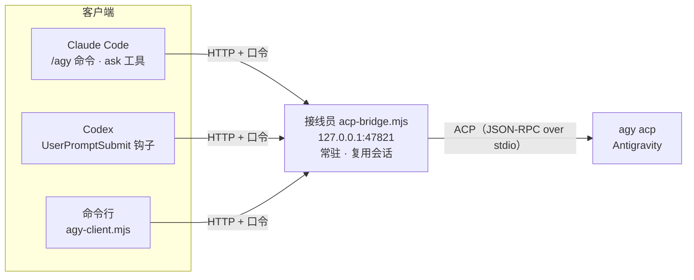

# antigravity-acp

在 **Claude Code** 和 **Codex** 里，把 **Antigravity**（`agy`）当子代理用。

底层走 **ACP**（Agent Client Protocol）：后台一直开着一个 `agy acp` 进程，所以不用每次重新启动。第一次调用要准备几秒，之后接着问通常 3～5 秒就回。

| | Claude Code | Codex |
| --- | --- | --- |
| 快捷调用 | `/agy 任务`（跳过 Claude 的 AI） | `/agy 任务` 或 `agy: 任务`（钩子拦截，跳过 Codex 的 AI） |
| 让 AI 去调用 | 直接说"让 Antigravity 帮我……" | `$agy 任务` |
| 插件目录 | [`claude/`](claude/) | [`codex/agy/`](codex/agy/) |
| 测试情况 | 已实测 | 只用模拟输入测过，还没在真实 Codex 里跑过 |

---

## ACP 工作方式

### 整体结构



- **接线员**（`bridge/acp-bridge.mjs`）只开一个 `agy acp` 进程，所有客户端共用它。
- 口令保存在 `~/.agy-acp/token`，第一次用时自动生成。不带口令的请求会被拒绝。
- 接线员只监听本机 `127.0.0.1`，外部网络连不上。

### 一次调用的过程


- **接着聊：** 同一个会话名会复用同一个 ACP 会话，Antigravity 记得前面聊过什么。Claude 里所有 `/agy` 共用一段对话，Codex 里每个聊天窗口各有一段。
- **重新开始：** 加 `--new` 就新开一个会话。
- **中途打断：** 接线员会发 `session/cancel` 让 Antigravity 停下。
- **出问题时：** `agy` 崩了，下次调用会自动重启它；接线员没开，客户端会自动把它拉起来。

> ⚠️ 除非设成只读，接线员会自动同意 Antigravity 提出的改文件、跑命令请求。请只在你允许它改动的文件夹里使用。

---

## 准备工作

1. 安装 [Node.js](https://nodejs.org/) 18 或更新版本。
2. 安装 Antigravity 的命令行 `agy`，确认在 PowerShell 里能运行 `agy --help`。
3. 登录一次：

```powershell
agy acp --login
```

---

## Claude Code

### 安装（PowerShell）

```powershell
irm https://raw.githubusercontent.com/lvdoushacc/antigravity-acp/main/install-claude.ps1 | iex
```

装完重开一个 Claude Code 对话就能用了。以后想更新，再运行一次这行就行。

### 使用

| 你输入 | 发生什么 |
| --- | --- |
| `/agy 帮我解释 src/main.ts` | 直接交给 Antigravity，结果显示在对话里，Claude 的 AI 不参与 |
| `/agy --new 重新开始，帮我写个脚本` | 忘掉之前的对话，新开一段 |
| `让 Antigravity 帮我查一下这个 bug` | Claude 自己写好任务，调用 `ask` 工具交给 Antigravity，再把结果告诉你 |

让 Claude 调用时，它还可以指定这些参数：`readOnly`（只看不改）、`session`（会话名）、`model`（比如 `gemini-4-neon-high`）、`cwd`（工作目录）、`timeoutSec`（超时）。

---

## Codex

### 安装（PowerShell）

```powershell
irm https://raw.githubusercontent.com/lvdoushacc/antigravity-acp/main/install-codex.ps1 | iex
```

这个脚本会做三件事：

1. 把插件复制到 `~/.codex/plugins/agy`。
2. 登记到 `~/.agents/plugins/marketplace.json`，你原来登记的插件会保留。
3. 在 `~/.codex/config.toml` 里启用它。

装完还要做两步：

1. 重启 Codex。
2. 在 **设置 > Hooks** 里信任这个插件的钩子（命令行版用 `/hooks`）。Codex 为了安全，不会自动信任新装的钩子。

### 使用

| 你输入 | 发生什么 |
| --- | --- |
| `/agy 帮我解释 src/main.ts` | 钩子拦下这句话，直接交给 Antigravity，结果显示出来，Codex 的 AI 不参与 |
| `agy: 帮我解释 src/main.ts` | 同上。如果 Codex 不认识 `/agy` 这个命令，就用这种写法 |
| `/agy --new 重新开始` | 这个聊天窗口新开一段对话 |
| `$agy 帮我查一下这个 bug` | 交给 Codex 的 AI，由它运行命令调用 Antigravity |

手动安装的步骤见 [`codex/agy/README.md`](codex/agy/README.md)。

---

## 常见问题

- **提示接线员没运行：** 确认 `node` 和 `agy` 都在 PATH 里。日志在 `~/.agy-acp/bridge.log`。
- **不用任何 AI 客户端，直接在终端里用：**

```powershell
node claude/bridge/agy-client.mjs "回复 pong"
```

- **端口冲突：** 默认端口是 `47821`，可以用环境变量 `AGY_ACP_PORT` 改掉，所有客户端要设成一样的值。

## License

MIT
